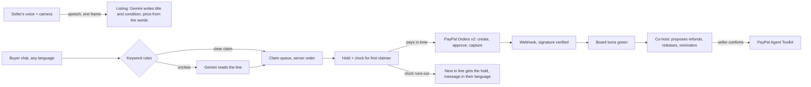

# Dibs


Dibs is for small resellers who sell on live video. It reads the chat, holds each item for whoever claimed it first, sends that buyer a PayPal checkout, and passes anything unpaid to the next person in line.

Built for the PayPal AI Hackathon. Everything runs on the PayPal sandbox; no real money moves.

| | |
|---|---|
| Live app | {{LIVE_URL}} |
| Judge mode, no setup | {{LIVE_URL}}/demo |
| Demo video (2:38) | {{VIDEO_URL}} |
| API collection | [`postman/dibs.postman_collection.json`](postman/dibs.postman_collection.json) |

## The problem

People sell thrift, vintage, sneakers and plants on live video, and in the US those shows sold about $14.6 billion of goods in 2025 ([eMarketer, via Digital Applied](https://www.digitalapplied.com/blog/social-commerce-statistics-2026-data-points)). The sale itself is a comment. A buyer types "mine" or "sold 14", and the seller, or a friend with a notepad, has to work out who typed first, then send payment requests by hand after the show. Guides for comment selling tell sellers to expect claims that never get paid and to set payment deadlines so the item can be released ([Racklify](https://racklify.com/encyclopedia/how-to-run-a-commentsold-comment-selling-event/)). By the time a seller notices, the second buyer has usually left.

Tools for this exist (CommentSold, SoldLive), but they charge a monthly fee, sit on top of a Shopify store and match keywords. Dibs runs from one link, takes payment straight into the seller's PayPal account, and reads claims the way people actually type them.

The demo show in the video was staged by the builder. No real seller has used Dibs yet.

## 60 seconds for judges

1. Open `/demo`. A scripted show starts on the real engine: lots come up and other viewers (bots) claim in English, Spanish, Hindi and Japanese. The left side shows how each line was read.
2. Join on the phone on the right and claim lot 3 (tap Dibs, or type "mine 3").
3. @jake claimed first and never pays. Watch his clock run out: lot 3 moves to you and you get a message.
4. Pay with the sandbox buyer shown on the page. The capture lands, PayPal's webhook is verified, and the board turns green.
5. Optional: open `/studio` in another tab to run your own show from your camera and mic.

## How it works



1. The seller says what the item is: "Lot three, leather bag, thirty five." The browser's speech recognition hears it, Dibs grabs a camera frame, and Gemini writes a short title and one honest line about condition. The price and lot number come from the seller's words, never from the model.
2. Buyers claim however they talk: "mine!!", "yo quiero la chaqueta 🙋‍♀️", "मुझे चाहिए 1", "2番ください", a raised hand. Clear claims are decided by keyword rules in milliseconds. Gemini reads only what the rules can't place, like slang, other scripts and "lol not mine, my sister wants it". All chat goes through one queue per show, so claims land in the order the server received them, whatever the model's latency. Translated replies run off that queue.
3. The first claimer gets a clock (2:00 by default) and a PayPal button on their phone. Everyone else waits in line and hears back in their own language.
4. When a hold runs out without a captured payment, it passes to the next person in line. If the first buyer approves in PayPal after their time is up, Dibs refuses to capture, so they aren't charged for something that went to someone else. While PayPal is capturing, the hold is locked so the clock can't sell the same lot twice.
5. PayPal confirms the sale. The money goes to the seller's own PayPal account if they gave one when starting the show.
6. After the show the seller asks the co-host: "Wrap up the show", "Who hasn't paid?", "Refund lot 2". It reads the show and PayPal, then proposes actions (a refund, ending an unpaid hold, a reminder). Nothing changes until the seller presses Confirm, and every proposal is re-checked against what PayPal captured at that moment.

## PayPal in Dibs

- Orders v2 through the PayPal TypeScript Server SDK (`@paypal/paypal-server-sdk`): one order per buyer with a line item per lot, `payee.email_address` set to the seller, and `PayPal-Request-Id` idempotency on create and capture. A repeated capture falls back to reading the order (`ORDER_ALREADY_CAPTURED`).
- The claim clock gates capture. The server checks every claim in the order is still held by that buyer and returns 409 if not.
- Webhooks register themselves on deploy and are checked with `/v1/notifications/verify-webhook-signature`. Unverified deliveries change nothing. Each event id is applied once. `PAYMENT.CAPTURE.COMPLETED` marks the sale, `DENIED` unlocks the hold, and `REFUNDED` updates the recap.
- PayPal Agent Toolkit gives the co-host order lookups, refund history and transaction search. `create_refund` is never offered to the model; it runs only after the seller confirms, with the amount checked against the captured line.
- Checkout buttons: PayPal, Venmo and Pay Later through the JS SDK.

## Gemini in Dibs

| Job | Model | If the model is slow or out of quota |
|---|---|---|
| Read unclear chat lines (JSON: claim, question or chatter, lot numbers, language) | `gemini-3.5-flash-lite`, 2.5 s timeout | keyword rules |
| Write a listing from the spoken words and a camera frame | `gemini-3.5-flash` | title from the spoken words |
| Translate replies to each buyer. Prices, handles and times are swapped for placeholders first, and a translation that changes any of them is thrown away | `gemini-3.5-flash-lite` | English |
| Co-host function-calling loop with the PayPal Agent Toolkit | `gemini-3.5-flash` | the seller uses PayPal directly |

The model never decides who gets an item and never moves money. Its output is validated with zod, and a low-confidence "claim" that the rules call chatter is treated as chatter.

## Evidence

Real sandbox runs on 11 November 2026, through Dibs' own endpoints:

| | |
|---|---|
| Order | `19Y34583SB393764D`, 2 lots, $65.00, approved by a US sandbox buyer |
| Capture | `55L4149684291294L`, COMPLETED. A second capture call returned the same result without a new charge. |
| Co-host refund | Asked "refund 15 dollars on lot 1", the co-host proposed it and nothing moved. After Confirm: refund `38E52394V7107161L` of $15.00 on capture `2UY924655E8922244`, COMPLETED. |
| Guard | Asked to refund $100 on the same lot, the proposal was refused in code: "lot 1 can only be refunded up to $25.00". |

44 automated tests (`npm test`), split between the domain and the HTTP server with a fake PayPal:

- claims, the claim order, double claims, handles that collide
- the clock: rollover, early release by the seller, no rollover in the middle of a capture
- capture: once per order, 409 after a lapsed hold without calling PayPal, unlock on a declined payment, another buyer's order refused, the seller's payee passed to PayPal
- buyer tokens: public ids rejected, tokens absent from the public snapshot
- webhooks: unverified ignored, duplicates applied once, refunds read from the capture link
- refund guard: unpaid lots, zero amounts and anything over the captured amount refused
- chat rules in English, Spanish, Hindi, French, German, Portuguese, Japanese and Chinese
- the translation guard keeps prices, handles and times

TypeScript runs in strict mode with `noUncheckedIndexedAccess`; CI type-checks, tests and builds on every push.

## Limitations and next steps

- Shows run from the Dibs studio and a shared link. Instagram's live comments webhook needs Meta app review, and YouTube Live chat has a public API; connecting those comes next.
- Video to buyers is a 5 fps JPEG stream over WebSocket, fine for showing items and not for long shows. WebRTC would replace it.
- Shows live in memory on one server process; a restart ends them. A database comes before any real seller uses it.
- The free Gemini tier is slow (1 to 2.5 s per call) and small. The rules handle the clear cases, so a show keeps working when the model is out of quota.
- Sandbox only. Live payments would need each seller onboarded through PayPal's partner flow instead of an email address.

## Run it locally

```bash
npm install
cp .env.example .env.local   # PayPal sandbox app (a US business account) and a Gemini key
npm run dev                  # API and WebSocket on :8787
npm run dev:web              # web app on :5173
npm test
```

Deploy: `render.yaml` describes the single web service (build `npm run build`, start `npm start`, health check `/api/health`).

## Repository map

```
src/server/domain/   claim engine, clock, rules parser (pure, tested)
src/server/paypal/   Orders v2 via the Server SDK, webhook registration and verification
src/server/ai/       Gemini calls with fallbacks; co-host loop and proposals
src/server/app.ts    HTTP and WebSocket routes (built with injected PayPal for tests)
src/server/room.ts   one show: sockets, chat queue, replies, checkout
src/server/demo.ts   judge-mode script
web/src/pages/       landing, studio, buyer room, judge mode
test/                vitest: domain and HTTP
```

## Built with

PayPal Orders v2, PayPal TypeScript Server SDK, PayPal Agent Toolkit, PayPal JS SDK, PayPal webhooks, Google Gemini, Fastify, React, Vite, TypeScript, Render.

Lot photos in judge mode are from Pexels (`web/public/demo/CREDITS.txt`). MIT license.
